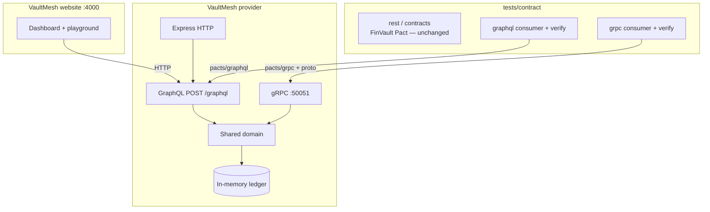
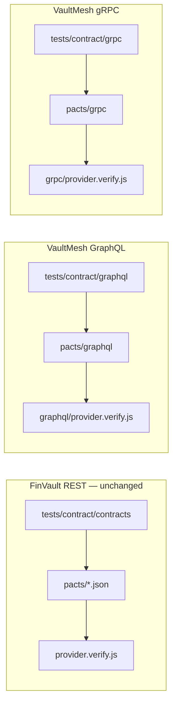

# VaultMesh — GraphQL + gRPC contract testing design

**Status:** v1  
**Project folder:** `C:\Project\contractTestingGraphQl`

---

## 1. Why a new app

FinVault (Cloudflare tunnel / EYDemo VM) is **REST only**. This repository does not own that backend, so GraphQL and gRPC cannot be bolted onto it.

VaultMesh is a small banking companion we fully control:

- One domain (auth, accounts, payments)
- Two protocol contracts (GraphQL SDL + gRPC proto)
- One website (the GraphQL target)
- Contract tests that follow the existing consumer → verify → report pattern

---

## 2. Target website and endpoints

| Surface | Local URL | Role |
|---------|-----------|------|
| **Website** | http://localhost:4000 | Login, accounts, transfer, GraphQL playground |
| **GraphQL** | `POST http://localhost:4000/graphql` | UI / BFF contract |
| **Health** | http://localhost:4000/health | Readiness for CI |
| **gRPC** | `localhost:50051` | Core banking RPCs (not a website) |
| **SDL** | http://localhost:4000/schema.graphql | GraphQL source of truth |
| **Proto** | http://localhost:4000/proto/vaultmesh.proto | gRPC source of truth |

Demo login: `demo@fintech.com` / `demo123`

gRPC has no browser URL. The website talks GraphQL; contract tests and `grpcurl` talk gRPC.

---

## 3. Architecture



**Rule:** GraphQL and gRPC are adapters. They must not diverge. If `accounts` and `ListAccounts` disagree, that is a contract defect.

---

## 4. Source of truth

| Protocol | Canonical artifact | Compatibility |
|----------|-------------------|---------------|
| GraphQL | `apps/vaultmesh/schema.graphql` | Additive fields OK. Remove/rename/type-change fails. |
| gRPC | `apps/vaultmesh/proto/vaultmesh/v1/vaultmesh.proto` | Field numbers stable. Never reuse. Enums append-only. |

Consumers must not invent fields. Tests assert against SDL / proto, not ad-hoc JSON.

---

## 5. Domain model (v1)

Seeded, deterministic, resettable via `POST /__contract__/states`.

| Entity | Demo data |
|--------|-----------|
| User | `user-001` · Alex Morgan · `demo@fintech.com` |
| Checking | `acc-checking` · USD · `12500.50` |
| Savings | `acc-savings` · USD · `8400.00` |

Operations:

1. **Login** — email + password → JWT + user  
2. **Me / current user** — JWT required  
3. **List / get accounts** — JWT required  
4. **Transfer** — JWT required; debit source, credit destination  

No database. Process memory is enough for local and CI demos. Provider state handlers call reset so transfer does not poison later interactions.

---

## 6. GraphQL contract

### Schema (v1)

```graphql
type Query {
  me: User
  accounts: [Account!]!
  account(id: ID!): Account
}

type Mutation {
  login(email: String!, password: String!): AuthPayload!
  transfer(fromAccountId: ID!, toAccountId: ID!, amount: Float!): TransferResult!
}
```

HTTP is always `POST /graphql` with `{ query, variables }`. GraphQL uses **status 200** even for auth failures; the contract is `errors[].extensions.code`.

| Operation | Auth | Happy contract | Failure contract |
|-----------|------|----------------|------------------|
| `login` | Public | `data.login.token` JWT, `user` shape | *(v1 skip)* |
| `me` | Bearer | `data.me` shape | `UNAUTHENTICATED` |
| `accounts` | Bearer | list of accounts, `balance` is Float | *(v1 skip)* |
| `transfer` | Bearer | `status`, `amount`, `id` | *(v1 skip)* |

**Non-goals:** subscriptions, federation, persisted queries, file uploads.

---

## 7. gRPC contract

Package: `vaultmesh.v1`  
Transport: plaintext locally (`localhost:50051`). TLS is out of v1.

| RPC | Auth metadata | Status OK body | Failure |
|-----|---------------|----------------|---------|
| `AuthService.Login` | none | `token`, `user` | `UNAUTHENTICATED` |
| `AccountService.ListAccounts` | `authorization: Bearer` | `accounts[]` | `UNAUTHENTICATED` |
| `AccountService.GetAccount` | Bearer | `Account` | `NOT_FOUND` / `UNAUTHENTICATED` |
| `PaymentService.Transfer` | Bearer | `id`, `status`, `amount` | `UNAUTHENTICATED` / `FAILED_PRECONDITION` |

**v1:** unary only. No client/server/bidi streaming.

Wire JSON in tests uses proto-loader camelCase (`fromAccountId`), not proto snake_case.

---

## 8. Auth design

Same identity story as FinVault.

| Channel | How |
|---------|-----|
| GraphQL | `Authorization: Bearer <jwt>` |
| gRPC | metadata `authorization: Bearer <jwt>` |
| Website | stores token in `sessionStorage` |

Provider verification **swaps** the mock JWT in contracts for a real token obtained via `login` (same idea as `auth-filter.js` on REST).

Public operations: GraphQL `login`, gRPC `Login`. Everything else requires a token.

JWT claims: `userId`, `email`. Secret: `VAULTMESH_JWT_SECRET` (dev default in config).

---

## 9. Contract testing design

Keep FinVault REST isolated. VaultMesh pacts **must not** land in `pacts/*.json` or the REST verifier will replay them against FinVault and fail.



| Step | GraphQL | gRPC |
|------|---------|------|
| Consumer | Jest + Pact V4 mock HTTP `POST /graphql` | Jest writes JSON RPC contract + mapper tests |
| Artifact | `pacts/graphql/*.json` | `pacts/grpc/*.json` |
| Provider verify | Pact Verifier → `:4000` | Custom verifier → `:50051` |
| Auth | Swap Bearer on `/graphql` | Login then attach metadata |
| State | `POST /__contract__/states` resets ledger | Same reset before each RPC |
| Schema gate (later) | GraphQL Inspector vs live SDL | `buf breaking` vs proto |

**Matchers**

- GraphQL: JWT regex, `like()` on user/account, `errors.extensions.code` exact  
- gRPC: status name (`OK`, `UNAUTHENTICATED`), string/number types, email exact  

**Breaking-change policy**

- Allowed: add optional GraphQL field; add proto field with a **new** number  
- Fail: remove/rename field; change type; reuse proto field number  

---

## 10. Repo layout

```
C:\Project\contractTestingGraphQl\
  schema.graphql
  proto/vaultmesh/v1/vaultmesh.proto
  src/                     domain + GraphQL + gRPC + HTTP
  ui/                      website
  tests/contract/graphql/
  tests/contract/grpc/
  START.bat
  RUN-TESTS.bat
```

Stack: **Node 20**, Express, `graphql`, `@grpc/grpc-js`. Same runtime as the existing Pact pipeline.

---

## 11. How to run

```bash
cd C:\Project\contractTestingGraphQl
npm install
npm start
```

Open http://localhost:4000. Keep that process running, then:

```bash
cd C:\Project\contractTestingGraphQl
npm test
```

---

## 12. CI (later)

Do **not** mix VaultMesh into the current FinVault `targetUrl` job.

Add a second job:

1. `npm install --prefix apps/vaultmesh`  
2. Start VaultMesh  
3. `npm run test:contract:vaultmesh`  
4. Publish `reports/vaultmesh-*.json` next to the REST HTML report  
5. Fail the build if either protocol fails  

Deploy to EYDemo VM is out of v1.

---

## 13. v1 scope

**In**

- Website + GraphQL + gRPC  
- 5 GraphQL interactions, 5 gRPC interactions  
- Shared domain + reset for provider states  
- Isolated pact folders and npm scripts  

**Out**

- Streaming / subscriptions  
- Real database  
- Pact Broker  
- Pact protobuf plugin (gRPC uses an explicit JSON RPC contract + proto)  
- TLS, retries, deadlines as contract clauses  
- Replacing FinVault REST tests  

---

## 14. Naming

| Role | Name |
|------|------|
| Website consumer | `VaultMesh-Web` |
| GraphQL provider | `VaultMesh-GraphQL` |
| gRPC provider | `VaultMesh-Core` |
| App | VaultMesh |
